# Diagrama de clases - Hotel Reservas

El diagrama representa las clases principales del sistema de reservas, organizadas por capas. Incluye las entidades del hotel, las interfaces de persistencia, las políticas de precios, las validaciones y las excepciones utilizadas por la aplicación.

```mermaid
classDiagram
    direction TB

    class Main {
        <<entrada de la aplicacion>>
        + main(String[]) void$
    }

    namespace ui {
        class HotelApp {
            - Scanner scanner
            - HotelService hotel
            - PricingPolicy standardPricing
            - PricingPolicy longStayPricing
            + HotelApp(HotelService, PricingPolicy, PricingPolicy)
            + start() void
            - printMenu() void
            - registerClient() void
            - registerEmployee() void
            - registerRoom() void
            - showClients() void
            - showEmployees() void
            - showPeople() void
            - showRooms() void
            - createReservation() void
            - showReservations() void
            - issueInvoice() void
            - showInvoices() void
            - payInvoice() void
            - cancelReservation() void
            - readText(String) String
            - readInt(String) int
            - readDouble(String) double
            - readDate(String) LocalDate
        }
    }

    namespace service {
        class HotelService {
            - Repository~Client~ clients
            - Repository~Employee~ employees
            - Repository~Room~ rooms
            - Repository~Reservation~ reservations
            - Repository~Invoice~ invoices
            + HotelService(Repository, Repository, Repository, Repository, Repository)
            + getClients() List~Client~
            + getEmployees() List~Employee~
            + getRooms() List~Room~
            + getReservations() List~Reservation~
            + getInvoices() List~Invoice~
            + registerClient(String, String, String, String, String, Category) Client
            + registerEmployee(String, String, String, String, String, Role, String, String) Employee
            + registerRoom(String, Type, int, double) Room
            + getPeople() List~Person~
            + createReservation(int, int, LocalDate, LocalDate, PricingPolicy) Reservation
            + issueInvoice(int, PaymentMethod) Invoice
            + payInvoice(int) void
            + cancelReservation(int) void
            - ensurePersonIsUnique(String, String, String) void
            - findClient(int) Client
            - findRoom(int) Room
            - findReservation(int) Reservation
            - findInvoice(int) Invoice
        }
    }

    namespace persistence {
        class Repository~T~ {
            <<interface>>
            + save(T) void
            + update(T) void
            + findById(int) Optional~T~
            + findAll() List~T~
            + nextId() int
        }
        class InMemoryRepository~T~ {
            - List~T~ entities
            + save(T) void
            + update(T) void
            + findById(int) Optional~T~
            + findAll() List~T~
            + nextId() int
        }
        class TextFileRepository~T~ {
            - Path file
            - EntityFileMapper~T~ mapper
            - List~T~ entities
            + TextFileRepository(Path, EntityFileMapper~T~)
            + save(T) void
            + update(T) void
            + findById(int) Optional~T~
            + findAll() List~T~
            + nextId() int
            - loadFromFile() void
            - writeToFile() void
        }
        class EntityFileMapper~T~ {
            <<interface>>
            + toLine(T) String
            + fromLine(String) T
        }
        class ClientFileMapper {
            + toLine(Client) String
            + fromLine(String) Client
        }
        class EmployeeFileMapper {
            + toLine(Employee) String
            + fromLine(String) Employee
        }
        class RoomFileMapper {
            + toLine(Room) String
            + fromLine(String) Room
        }
        class ReservationFileMapper {
            - Repository~Client~ clients
            - Repository~Employee~ employees
            - Repository~Room~ rooms
            + ReservationFileMapper(Repository, Repository, Repository)
            + toLine(Reservation) String
            + fromLine(String) Reservation
        }
        class InvoiceFileMapper {
            - Repository~Reservation~ reservations
            + InvoiceFileMapper(Repository)
            + toLine(Invoice) String
            + fromLine(String) Invoice
        }
        class DelimitedText {
            <<utility>>
            + join(String...) String$ 
            + split(String) List~String~$
            + requireFieldCount(String, int) List~String~$
        }
    }

    namespace model {
        class Identifiable {
            <<interface>>
            + getId() int
        }
        class Person {
            <<abstract>>
            - int id
            - String name
            - String documentNumber
            - String email
            - String phone
            - String city
            - boolean active
            # Person(int, String, String, String, String, String)
            + describe()* String
            + activate() void
            + deactivate() void
            + getId() int
            + getName() String
            + getDocumentNumber() String
            + getEmail() String
            + setEmail(String) void
            + getPhone() String
            + setPhone(String) void
            + getCity() String
            + setCity(String) void
            + isActive() boolean
        }
        class Client {
            - Category category
            + Client(int, String, String, String, String, String, Category)
            + getCategory() Category
            + changeCategory(Category) void
            + describe() String
        }
        class Employee {
            - Role role
            - String username
            - String password
            + Employee(int, String, String, String, String, String, Role, String, String)
            + getRole() Role
            + changeRole(Role) void
            + getUsername() String
            + getPassword() String
            + changePassword(String) void
            + describe() String
        }
        class Room {
            - int id
            - String number
            - Type type
            - int capacity
            - double pricePerNight
            - boolean available
            + Room(int, String, Type, int, double, boolean)
            + markAvailable() void
            + markUnavailable() void
            + getId() int
            + getNumber() String
            + getType() Type
            + getCapacity() int
            + getPricePerNight() double
            + setPricePerNight(double) void
            + isAvailable() boolean
        }
        class Reservation {
            - int id
            - Client client
            - Employee employee
            - Room room
            - LocalDate checkIn
            - LocalDate checkOut
            - double pricePerNight
            - double total
            - Status status
            + Reservation(int, Client, Employee, Room, LocalDate, LocalDate, double, double, Status)
            + create(int, Client, Employee, Room, LocalDate, LocalDate, PricingPolicy)$ Reservation
            + nights() long
            + isActive() boolean
            + cancel() void
            + occupies(Room, LocalDate, LocalDate) boolean
            + getId() int
            + getClient() Client
            + getEmployee() Employee
            + getRoom() Room
            + getCheckIn() LocalDate
            + getCheckOut() LocalDate
            + getPricePerNight() double
            + getTotal() double
            + getStatus() Status
        }
        class Invoice {
            - int id
            - Reservation reservation
            - LocalDate issueDate
            - double amount
            - PaymentMethod paymentMethod
            - Status status
            + Invoice(int, Reservation, LocalDate, double, PaymentMethod, Status)
            + issue(int, Reservation, PaymentMethod)$ Invoice
            + pay() void
            + annul() void
            + getId() int
            + getReservation() Reservation
            + getIssueDate() LocalDate
            + getAmount() double
            + getPaymentMethod() PaymentMethod
            + getStatus() Status
        }
        class PricingPolicy {
            <<interface>>
            + calculateTotal(double, long) double
        }
        class StandardPricing {
            + calculateTotal(double, long) double
        }
        class LongStayPricing {
            - int minNights
            - double discountPercent
            + LongStayPricing(int, double)
            + calculateTotal(double, long) double
        }
        class ClientCategory {
            <<enumeration>>
            NEW
            FREQUENT
            VIP
        }
        class EmployeeRole {
            <<enumeration>>
            ADMIN
            RECEPTIONIST
        }
        class RoomType {
            <<enumeration>>
            SINGLE
            DOUBLE
            SUITE
        }
        class ReservationStatus {
            <<enumeration>>
            ACTIVE
            CANCELLED
        }
        class PaymentMethod {
            <<enumeration>>
            CASH
            CARD
            TRANSFER
        }
        class InvoiceStatus {
            <<enumeration>>
            PENDING
            PAID
            VOIDED
        }
    }

    namespace validation {
        class Validator {
            <<utility>>
            - Validator()
            + requireNonNull(T, String)$ T
            + requireText(String, String, int)$ String
            + requirePositive(int, String)$ int
            + requirePositive(double, String)$ double
            + requirePercentage(double, String)$ double
            + requireEmail(String)$ String
            + requirePhone(String)$ String
        }
    }

    namespace exceptions {
        class HotelException {
            <<abstract>>
            # HotelException(String)
        }
        class BusinessRuleException {
            + BusinessRuleException(String)
        }
        class InvalidDataException {
            + InvalidDataException(String)
        }
        class ResourceNotFoundException {
            + ResourceNotFoundException(String)
        }
    }

    %% Inicio y coordinacion de la aplicacion
    Main --> HotelApp
    Main --> HotelService
    Main --> TextFileRepository
    Main --> ClientFileMapper
    Main --> EmployeeFileMapper
    Main --> RoomFileMapper
    Main --> ReservationFileMapper
    Main --> InvoiceFileMapper
    Main --> StandardPricing
    Main --> LongStayPricing

    %% Interfaz y servicio
    HotelApp --> HotelService
    HotelApp --> PricingPolicy
    HotelService ..> PricingPolicy : usa al crear reservas

    %% Contratos e implementaciones de persistencia
    InMemoryRepository ..|> Repository
    TextFileRepository ..|> Repository
    ClientFileMapper ..|> EntityFileMapper
    EmployeeFileMapper ..|> EntityFileMapper
    RoomFileMapper ..|> EntityFileMapper
    ReservationFileMapper ..|> EntityFileMapper
    InvoiceFileMapper ..|> EntityFileMapper
    TextFileRepository --> EntityFileMapper : convierte registros
    TextFileRepository --> DelimitedText : usa
    ClientFileMapper --> DelimitedText : usa
    EmployeeFileMapper --> DelimitedText : usa
    RoomFileMapper --> DelimitedText : usa
    ReservationFileMapper --> DelimitedText : usa
    InvoiceFileMapper --> DelimitedText : usa
    ReservationFileMapper --> Repository : consulta cliente, trabajador y habitacion
    InvoiceFileMapper --> Repository : consulta reserva

    %% Servicio hacia repositorios
    HotelService --> Repository : clientes
    HotelService --> Repository : trabajadores
    HotelService --> Repository : habitaciones
    HotelService --> Repository : reservas
    HotelService --> Repository : comprobantes

    %% Herencia e interfaces del modelo
    Person ..|> Identifiable
    Client --|> Person
    Employee --|> Person
    Room ..|> Identifiable
    Reservation ..|> Identifiable
    Invoice ..|> Identifiable
    StandardPricing ..|> PricingPolicy
    LongStayPricing ..|> PricingPolicy

    %% Relaciones entre entidades
    Reservation --> Client : cliente
    Reservation --> Employee : trabajador opcional
    Reservation --> Room : habitacion reservada
    Invoice --> Reservation : comprobante de reserva
    Client --> ClientCategory : categoria
    Employee --> EmployeeRole : rol
    Room --> RoomType : tipo
    Reservation --> ReservationStatus : estado
    Invoice --> PaymentMethod : metodo de pago
    Invoice --> InvoiceStatus : estado

    %% Validacion y excepciones
    Person ..> Validator : valida datos personales
    Client ..> Validator : valida categoria
    Employee ..> Validator : valida rol y credenciales
    Room ..> Validator : valida datos
    Reservation ..> Validator : valida datos
    Invoice ..> Validator : valida datos
    LongStayPricing ..> Validator : valida configuracion
    Reservation ..> BusinessRuleException
    Reservation ..> InvalidDataException
    Invoice ..> BusinessRuleException
    Validator ..> InvalidDataException
    HotelService ..> BusinessRuleException
    HotelService ..> ResourceNotFoundException
    BusinessRuleException --|> HotelException
    InvalidDataException --|> HotelException
    ResourceNotFoundException --|> HotelException
    HotelException --|> RuntimeException
```

