# Diagrama de jerarquías - Hotel Reservas

Este diagrama muestra las jerarquías de herencia y las implementaciones de interfaces utilizadas en Hotel Reservas. Las clases se agrupan por el papel que cumplen en el modelo y en la persistencia.

```mermaid
classDiagram
    direction TB

    %% Jerarquia de personas
    class Person {
        <<abstract>>
    }
    class Client
    class Employee

    Person <|-- Client
    Person <|-- Employee

    %% Contrato de identificacion
    class Identifiable {
        <<interface>>
    }

    Person ..|> Identifiable
    Room ..|> Identifiable
    Reservation ..|> Identifiable
    Invoice ..|> Identifiable

    %% Politicas de precios
    class PricingPolicy {
        <<interface>>
    }
    class StandardPricing
    class LongStayPricing

    StandardPricing ..|> PricingPolicy
    LongStayPricing ..|> PricingPolicy

    %% Contrato generico de persistencia e implementaciones
    class Repository~T~ {
        <<interface>>
    }
    class InMemoryRepository~T~
    class TextFileRepository~T~

    InMemoryRepository ..|> Repository
    TextFileRepository ..|> Repository

    %% Contrato para convertir entidades a texto y viceversa
    class EntityFileMapper~T~ {
        <<interface>>
    }
    class ClientFileMapper
    class EmployeeFileMapper
    class RoomFileMapper
    class ReservationFileMapper
    class InvoiceFileMapper

    ClientFileMapper ..|> EntityFileMapper
    EmployeeFileMapper ..|> EntityFileMapper
    RoomFileMapper ..|> EntityFileMapper
    ReservationFileMapper ..|> EntityFileMapper
    InvoiceFileMapper ..|> EntityFileMapper

    %% Jerarquia de excepciones
    class RuntimeException {
        <<Java>>
    }
    class HotelException {
        <<abstract>>
    }
    class BusinessRuleException
    class InvalidDataException
    class ResourceNotFoundException

    RuntimeException <|-- HotelException
    HotelException <|-- BusinessRuleException
    HotelException <|-- InvalidDataException
    HotelException <|-- ResourceNotFoundException
```

