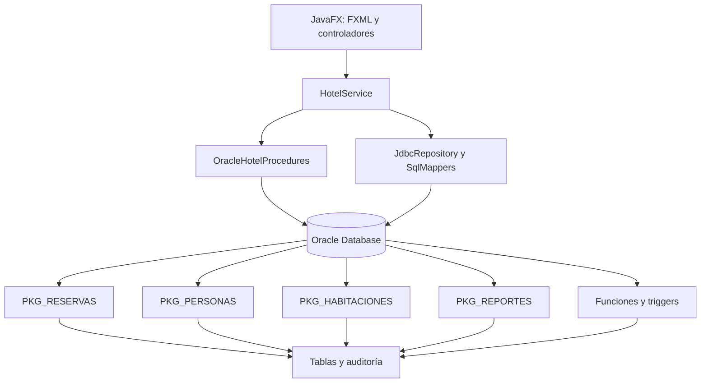

# Diagrama de capas — HotelReservas

La aplicación utiliza JavaFX como presentación, `HotelService` como fachada, JDBC como comunicación y Oracle como responsable de las reglas de negocio y el almacenamiento.

- Los controladores no contienen consultas SQL ni calculan reglas de negocio.
- `HotelService` convierte los datos de Java a los parámetros de Oracle y recupera los registros para mostrarlos.
- `OracleHotelProcedures` agrupa las llamadas a procedimientos, funciones y cursores PL/SQL.
- `JdbcRepository` consulta registros; no expone operaciones de escritura.
- Los paquetes Oracle centralizan las validaciones y operaciones que modifican datos.
