# Diagrama de capas - Hotel Reservas

El diagrama representa la arquitectura actual de Hotel Reservas: interfaz de consola, servicios, persistencia en archivos de texto, modelo del dominio, validaciones y excepciones. La clase `Main` conecta las implementaciones concretas al iniciar la aplicación.

```mermaid
classDiagram
    direction TB

    namespace UI_Layer {
        class HotelApp {
            <<UI>>
        }
    }

    namespace Service_Layer {
        class HotelService {
            <<Service>>
        }
    }

    namespace Persistence_Layer {
        class Repository~T~ {
            <<Interface>>
        }
        class InMemoryRepository~T~ {
        }
        class TextFileRepository~T~ {
        }
        class EntityFileMapper~T~ {
            <<Interface>>
        }
        class ClientFileMapper {
        }
        class EmployeeFileMapper {
        }
        class RoomFileMapper {
        }
        class ReservationFileMapper {
        }
        class InvoiceFileMapper {
        }
        class DelimitedText {
            <<Utility>>
        }
    }

    namespace Validation_Layer {
        class Validator {
            <<Utility>>
        }
    }

    namespace Exception_Layer {
        class HotelException {
            <<Abstract>>
        }
        class BusinessRuleException {
        }
        class InvalidDataException {
        }
        class ResourceNotFoundException {
        }
    }

    namespace Model_Layer {
        class Identifiable {
            <<Interface>>
        }
        class Person {
            <<Abstract>>
        }
        class Client {
        }
        class Employee {
        }
        class Room {
        }
        class Reservation {
        }
        class Invoice {
        }
        class PricingPolicy {
            <<Interface>>
        }
        class StandardPricing {
        }
        class LongStayPricing {
        }
    }

    %% Entrada y composicion de dependencias
    class RuntimeException {
        <<Java>>
    }
    class Main {
        <<Application Entry>>
    }
    class DataFiles {
        <<Archivos de texto en data/>>
    }

    Main ..> HotelApp : crea e inicia
    Main ..> HotelService : construye e inyecta
    Main ..> TextFileRepository : configura repositorios
    Main ..> ClientFileMapper : configura
    Main ..> EmployeeFileMapper : configura
    Main ..> RoomFileMapper : configura
    Main ..> ReservationFileMapper : configura
    Main ..> InvoiceFileMapper : configura
    Main ..> StandardPricing : crea politica
    Main ..> LongStayPricing : crea politica

    %% UI -> Service
    HotelApp ..> HotelService : usa los casos de uso
    HotelApp ..> PricingPolicy : recibe politicas de precio
    HotelApp ..> HotelException : presenta errores de la aplicacion
    HotelApp ..> Client : muestra resultados
    HotelApp ..> Employee : muestra resultados
    HotelApp ..> Person : muestra resultados conjuntos
    HotelApp ..> Room : muestra resultados
    HotelApp ..> Reservation : muestra resultados
    HotelApp ..> Invoice : muestra resultados

    %% Service -> contratos de persistencia y modelo
    HotelService ..> Repository : usa repositorios de datos
    HotelService ..> Client : registra y consulta
    HotelService ..> Employee : registra y consulta
    HotelService ..> Room : registra y consulta
    HotelService ..> Reservation : crea y cancela
    HotelService ..> Invoice : emite y paga
    HotelService ..> PricingPolicy : calcula el precio de una reserva
    HotelService ..> BusinessRuleException : informa reglas incumplidas
    HotelService ..> ResourceNotFoundException : informa recursos inexistentes

    %% Contrato e implementaciones de persistencia
    InMemoryRepository ..|> Repository
    Repository ..> Identifiable : exige identificadores
    EntityFileMapper ..> Identifiable : convierte entidades identificables
    TextFileRepository ..|> Repository
    ClientFileMapper ..|> EntityFileMapper
    EmployeeFileMapper ..|> EntityFileMapper
    RoomFileMapper ..|> EntityFileMapper
    ReservationFileMapper ..|> EntityFileMapper
    InvoiceFileMapper ..|> EntityFileMapper

    TextFileRepository ..> EntityFileMapper : convierte entidades y registros
    TextFileRepository ..> DataFiles : lee y escribe archivos
    ClientFileMapper ..> Client : convierte
    EmployeeFileMapper ..> Employee : convierte
    RoomFileMapper ..> Room : convierte
    ReservationFileMapper ..> Reservation : convierte
    InvoiceFileMapper ..> Invoice : convierte
    ReservationFileMapper ..> Repository : busca cliente, trabajador y habitacion
    InvoiceFileMapper ..> Repository : busca reserva

    ClientFileMapper ..> DelimitedText : une y separa campos
    EmployeeFileMapper ..> DelimitedText : une y separa campos
    RoomFileMapper ..> DelimitedText : une y separa campos
    ReservationFileMapper ..> DelimitedText : une y separa campos
    InvoiceFileMapper ..> DelimitedText : une y separa campos

    %% Jerarquias e implementaciones del modelo
    Person <|-- Client
    Person <|-- Employee
    Person ..|> Identifiable
    Room ..|> Identifiable
    Reservation ..|> Identifiable
    Invoice ..|> Identifiable
    StandardPricing ..|> PricingPolicy
    LongStayPricing ..|> PricingPolicy

    %% Relaciones entre entidades del dominio
    Reservation --> Client : cliente de la reserva
    Reservation --> Employee : trabajador asociado
    Reservation --> Room : habitacion reservada
    Invoice --> Reservation : comprobante de la reserva

    %% Validacion y excepciones
    Person ..> Validator : valida datos personales
    Client ..> Validator : valida datos de cliente
    Employee ..> Validator : valida datos del trabajador
    Room ..> Validator : valida datos de habitacion
    Reservation ..> Validator : valida datos de reserva
    Invoice ..> Validator : valida datos del comprobante
    LongStayPricing ..> Validator : valida configuracion de tarifa
    Validator ..> InvalidDataException : lanza cuando un dato es invalido

    Reservation ..> BusinessRuleException : reglas de reserva
    Reservation ..> InvalidDataException : datos invalidos
    Invoice ..> BusinessRuleException : reglas de pago y anulacion
    HotelException <|-- BusinessRuleException
    HotelException <|-- InvalidDataException
    HotelException <|-- ResourceNotFoundException
    RuntimeException <|-- HotelException
```

